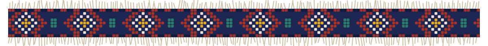

Hi, I'm Shahi.

I studied computer science at the University of Oslo, and these days I'm doing a master's in entrepreneurship and innovation. Most of the code I write sits on the backend: APIs, data, and keeping things secure. The master's covers the other half of the job, which is working out who actually needs the thing and how it reaches them.

Outside of code I switch between Norwegian, English, Kurdish, Spanish and Arabic, sometimes in the same sentence.

I'm open to internships, part-time developer roles and early-stage startup projects. The easiest way to reach me is [shahi55@outlook.com](mailto:shahi55@outlook.com), or find me on [LinkedIn](https://www.linkedin.com/in/YOUR-LINKEDIN/) and [Credly](https://www.credly.com/users/YOUR-CREDLY/).

 

<picture><source media="(prefers-color-scheme: dark)" srcset="./assets/h-built-dark.svg"></picture>

<a href="https://github.com/ShahiFtah/Sunify_SolcelleApp"><picture><source media="(prefers-color-scheme: dark)" srcset="./assets/projects/sunify-dark.svg"></picture></a>
<a href="https://github.com/ShahiFtah/AquaFlow"><picture><source media="(prefers-color-scheme: dark)" srcset="./assets/projects/aquaflow-dark.svg"></picture></a>
<a href="https://github.com/ShahiFtah/MyOwnFlappyBird"><picture><source media="(prefers-color-scheme: dark)" srcset="./assets/projects/flappy-dark.svg"></picture></a>
<a href="https://github.com/ShahiFtah/Note-app"><picture><source media="(prefers-color-scheme: dark)" srcset="./assets/projects/notes-dark.svg"></picture></a>
<a href="https://github.com/ShahiFtah/Sorting-Algorithm"><picture><source media="(prefers-color-scheme: dark)" srcset="./assets/projects/sorting-dark.svg"></picture></a>

 

<picture><source media="(prefers-color-scheme: dark)" srcset="./assets/h-tools-dark.svg"></picture>

<picture><source media="(prefers-color-scheme: dark)" srcset="./assets/tools-dark.svg"></picture>

 

<picture><source media="(prefers-color-scheme: dark)" srcset="./assets/h-year-dark.svg"></picture>

<picture><source media="(prefers-color-scheme: dark)" srcset="./assets/year-dark.svg"></picture>

 

The header is a kilim, woven row by row like on a loom. Punch cards came from looms like that, so it felt like the right place to start. The rug above is my real contribution calendar, rewoven every night. Type is Schibsted Grotesk, made in Oslo. Everything is generated by <code>build.py</code>.
